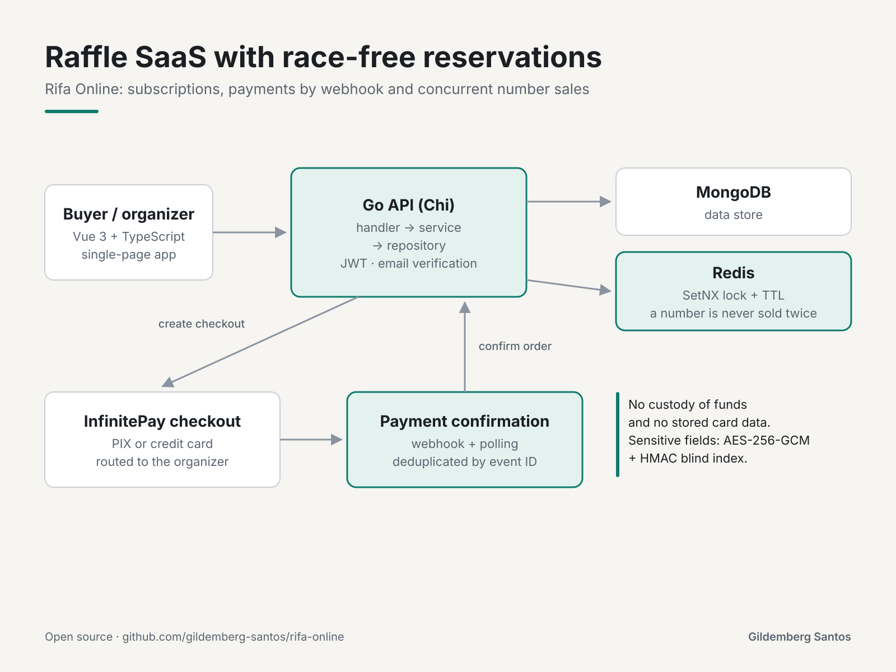

# Rifa Online

[Português](README.pt-BR.md)

A SaaS platform for **creating and running online raffles**, with PIX and credit card payments through [InfinitePay](https://www.infinitepay.io/). Organizers subscribe to the service to create raffles and run draws; participants buy numbers without creating an account.

- **Frontend:** Vue 3 + TypeScript + Vite + Tailwind CSS
- **Backend:** Go (Chi) + MongoDB + Redis
- **Payments:** InfinitePay Checkout (PIX and card)



> Detailed product and technical documentation lives in [`docs/`](#documentation) (in Portuguese). End-user tutorials live inside the app, in the **Help Center** (`/ajuda`).

---

## Repository structure

```
.
├── backend/                 # Go API
│   ├── cmd/server/main.go   # entry point (routes, bootstrap)
│   ├── internal/
│   │   ├── handler/         # HTTP layer
│   │   ├── service/         # business rules
│   │   ├── repository/      # MongoDB access
│   │   ├── model/           # data models
│   │   ├── middleware/      # auth, admin, subscription, logging
│   │   ├── migrations/      # index creation
│   │   ├── mailer/          # email sending (SMTP)
│   │   └── config/          # env loading
│   └── pkg/infinitepay/     # InfinitePay HTTP client
├── frontend/                # Vue 3 SPA
│   └── src/
│       ├── pages/           # screens (including legal/ and the Help Center)
│       ├── components/      # reusable components
│       ├── layouts/         # Navbar, Footer
│       ├── data/help.ts     # Help Center content
│       ├── stores/          # Pinia
│       └── router/          # routes
├── docs/                    # PRD, Tech Spec, Tasks
├── docker-compose.yml
└── Makefile
```

---

## Requirements

- **Go** 1.23+
- **Node.js** 20+ and npm
- **Docker** + Docker Compose (for MongoDB/Redis or to run everything)

---

## Running

### Option A — Everything in Docker (simplest)

```bash
cp .env.example .env          # set INFINITEPAY_HANDLE and JWT_SECRET
make docker-up                # starts mongodb, redis, backend and frontend
```

- Frontend: http://localhost:5173
- Backend:  http://localhost:8080  (health: `/health`)

### Option B — Local development (native backend and frontend)

```bash
make setup                    # copies backend/.env, installs frontend deps, go mod tidy
make db-up                    # starts only mongodb and redis in Docker
```

> ⚠️ **Ports:** `docker-compose` exposes MongoDB on **27018** and Redis on **6380** on the host (to avoid clashing with local instances). When running the backend natively, adjust `backend/.env`:
>
> ```env
> MONGODB_URI=mongodb://localhost:27018
> REDIS_URI=redis://localhost:6380
> ```

```bash
make dev-backend              # API on :8080 (or `make dev-backend-hot` with air)
make dev-frontend             # Vite on :5173
```

A default admin user is created automatically: **admin@email.com** / **123456** (development only).

---

## Environment variables (backend)

| Variable | Default | Description |
|----------|---------|-------------|
| `PORT` | `8080` | API port |
| `MONGODB_URI` | `mongodb://localhost:27017` | MongoDB connection |
| `MONGODB_DB_NAME` | `rifaonline` | Database name |
| `REDIS_URI` | `redis://localhost:6379` | Redis connection (reservation locks) |
| `JWT_SECRET` | `change-me` | JWT signing secret — **change it in production** |
| `APP_ENV` | `development` | `development` enables dev-only routes (e.g. `dev-checkout`) |
| `INFINITEPAY_HANDLE` | _(empty)_ | Platform handle (receives subscriptions) |
| `INFINITEPAY_BASE_URL` | `https://api.checkout.infinitepay.io` | InfinitePay API base URL |
| `FRONTEND_URL` | `http://localhost:5173` | Frontend URL (CORS + redirect after payment) |
| `APP_URL` | `http://localhost:8080` | Backend URL (used as the checkout `webhook_url`) |
| `SMTP_HOST` | _(empty)_ | SMTP host for email. Empty = email verification disabled |
| `SMTP_PORT` | `587` | SMTP port |
| `SMTP_USER` | _(empty)_ | SMTP user |
| `SMTP_PASS` | _(empty)_ | SMTP password |
| `SMTP_FROM` | _(empty)_ | Sender address |
| `DATA_ENCRYPTION_KEY` | _(empty)_ | Key for encrypting sensitive fields at rest (AES-256-GCM). Empty = no encryption |
| `BLIND_INDEX_KEY` | _(empty)_ | Blind index (HMAC) key for searching encrypted fields |
| `LOG_LEVEL` | `info` | `debug` \| `info` \| `warn` \| `error` |
| `LOG_FORMAT` | `text` | `text` \| `json` |

The frontend uses `VITE_API_URL` (optional) as the API base; empty = same origin (`/api/v1`).

---

## Useful commands (Makefile)

| Command | What it does |
|---------|--------------|
| `make dev-backend` / `make dev-frontend` | Run backend / frontend in dev mode |
| `make build` | Build the backend (`bin/server`) and frontend (`dist/`) |
| `make test` | Run backend (`go test`) and frontend (`vitest`) tests |
| `make lint` | `go vet` + `vue-tsc`/eslint |
| `make docker-up` / `make docker-down` | Start / stop the whole stack |
| `make db-up` / `make db-down` | Start / stop only MongoDB and Redis |
| `make clean` | Remove build artifacts |

---

## API

Base: `/api/v1`. Authentication with **JWT** (access + refresh); admin routes require `role=ADMIN`. New accounts must verify their email before receiving tokens (when SMTP is configured).

The **full endpoint reference** (auth, profile, subscription, raffles, payments, dashboard, admin, contact and webhooks) is in [`docs/TECH_SPEC.md` §4](docs/TECH_SPEC.md). The **payment integration** (checkout creation, webhook, `payment_check`, lifecycle) is in [`docs/TECH_SPEC.md` §5](docs/TECH_SPEC.md) and, in plain language, in the Help Center (`/ajuda/integracao-pagamento-infinitepay`).

---

## Documentation

### Technical / product (`docs/`, in Portuguese)
- [PRD.md](docs/PRD.md) — product vision, personas, features and flows
- [TECH_SPEC.md](docs/TECH_SPEC.md) — stack, architecture, data model, API and integration
- [TASKS.md](docs/TASKS.md) — task tracking

### In the app (end users)
- **Help Center** — `/ajuda` (tutorials per role: organizer, participant, admin, payments)
- **Contact** — `/contato` (support channel; messages are read in the admin panel)
- **Legal documents** — `/termos-de-uso`, `/politica-de-privacidade`, `/politica-de-cookies`, `/termo-do-organizador`

---

## Architecture decisions (summary)

- **Layers:** `handler` → `service` → `repository`; `pkg/infinitepay` isolates the payment client.
- **Concurrency:** number reservations use a **Redis lock** (`SetNX`, TTL) to prevent double sales.
- **Payments:** the platform **does not hold funds** or **store card data** — everything is processed by InfinitePay and routed by the organizer's `handle`.
- **Idempotent confirmation:** webhook + polling (`payment_check`), deduplicated by `eventId`.
- **Email verification:** new accounts confirm their email with a 6-digit code (30 min expiry). Without SMTP configured, accounts are created already verified (dev compatibility).
- **Cryptographic draw:** uses `crypto/rand` instead of `time.Now().UnixNano()` for an unbiased winner draw.

For details, see [`docs/TECH_SPEC.md`](docs/TECH_SPEC.md).
